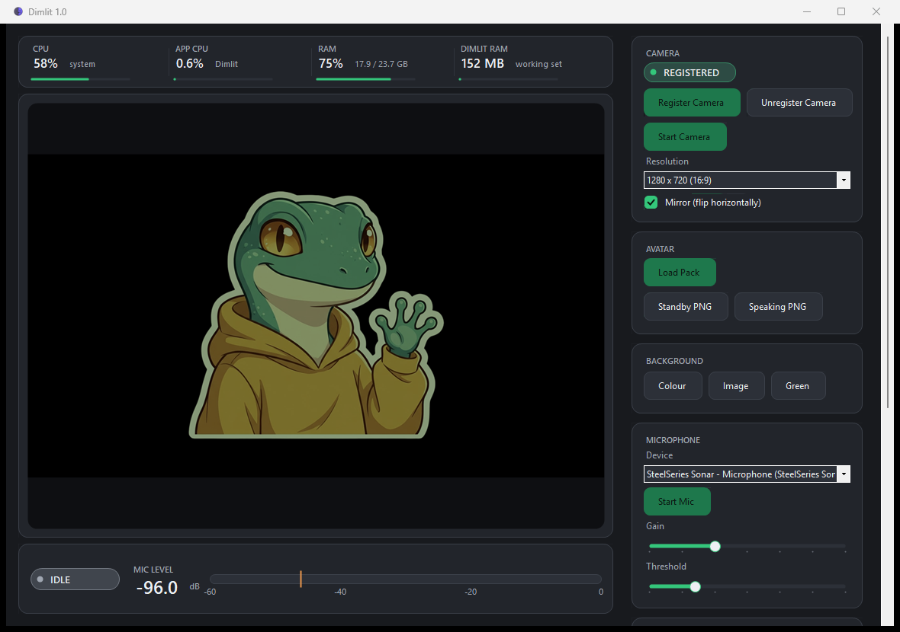

# Dimlit

A portable Windows 11 app that turns a set of PNG images into a virtual webcam and switches
between them based on your microphone. No OBS required.

**Current version: 1.0**



---

## 1. What Dimlit is

Dimlit shows a PNG avatar as a real camera device, so any app that lists a camera can use it.
You talk, the avatar talks. You stop, it dims and goes quiet. It is built for streamers, VTubers
and anyone who wants a PNGTuber avatar in Discord, Teams, OBS or a browser without installing a
full streaming suite.

**Features**

- **Standby and speaking images.** Any two PNGs, or a pack folder with `standby.png` and
  `speaking.png`.
- **Microphone reactive.** Adjustable input gain, a live dB meter with a draggable threshold
  line, plus hysteresis and a release delay so the avatar does not flicker between words.
- **Dim and bloom.** The standby image is dimmed and slightly desaturated. On speech it blooms
  back to full colour, then eases down again.
- **Bounce.** An optional spring-style bounce while speaking, with adjustable amount and speed.
- **Blink.** An optional blink image shown at random intervals while idle. The file in the pack
  must be named `standby_blink.png`. The spelling matters, so spell `standby` out in full rather
  than shortening it.
- **Backgrounds.** Solid colour, background image, or green screen.
- **Resolution.** 1280x720, 1280x1280, 720x720, 1920x1080, 1080x1080 or 1280x960.
- **Aspect correct.** The avatar keeps its ratio and is letterboxed, so a square image is not
  stretched.
- **Mirror.** Flips the camera output horizontally.
- **Resource strip.** System CPU, Dimlit CPU, physical RAM and the Dimlit working set, sampled
  once per second at the top left of the window.
- **Dashboard UI.** Dark canvas, rounded cards, status pills and large numeric readouts.
- **Tray icon.** Minimize to tray with a quick camera on/off toggle.
- **Portable.** `settings.json` sits next to the exe. Nothing is written to AppData or the
  registry, except one machine-wide entry to register the camera. Move the folder to another PC
  and it still works.

**How it works.** Windows loads virtual cameras inside the Frame Server service, not inside the
app, so Dimlit is split into three parts. `Dimlit.Host.exe` creates the virtual camera and keeps
it alive. `Dimlit.Source.dll` runs inside the Frame Server and renders the frames. `Dimlit.App.exe`
is the window you interact with: microphone capture, speaking detection, image rendering, tray and
settings. The App writes the current frame and state, the DLL picks them up, and Media Foundation
hands the frame to whatever app opened the camera. Closing the App removes the camera.

**Requirements**

- Windows 11, build 22000 or newer. Windows 10 has not been tested, and it is not expected to
  work. Dimlit creates its camera with `MFCreateVirtualCamera` from `mfsensorgroup.dll`, which
  Microsoft documents as available from Windows build 22000 (Windows 11) only. Windows 10 has no
  equivalent virtual-camera API, so a Windows 10 build would need a separate camera driver. That
  is not planned at the moment.
- Administrator approval once, to register the camera DLL. The app asks for it on the first run.
- No .NET install needed. The app is self-contained and the camera DLL is native.

**Privacy.** Dimlit runs entirely on your machine. Audio is processed in memory to measure a
level. Nothing is recorded, stored or sent anywhere.

**Attribution.** Built on [smourier/VCamNetSample](https://github.com/smourier/VCamNetSample),
MIT licensed. See `THIRD-PARTY-NOTICES.txt`.

---

## 2. Quick start

Download `Dimlit.V1.0.zip` from the **Releases** page and extract it, or take the files below from
this repository and keep them in **one folder**:

```
Dimlit.App.exe            the app you run
Dimlit.Source.dll         the camera
Dimlit.Host.exe           owns the virtual camera
THIRD-PARTY-NOTICES.txt   license text
avatars\                  put avatar packs here
```

Then:

1. Run `Dimlit.App.exe`.
2. Click **Register Camera** and accept the UAC prompt. This is needed once per folder. If you
   later move the folder, register again.
3. Pick your microphone in the dropdown, then click **Start Mic**.
4. Load an avatar. Use **Load Pack** for a folder holding `standby.png` and `speaking.png`, or
   load **Standby PNG** and **Speaking PNG** separately. For blinking while idle, also put a
   `standby_blink.png` in the pack folder.
5. Open your app and select the camera.

**Using it in Discord**

Settings, Voice & Video, Camera, then choose `Dimlit` from the list. Discord sometimes needs a
restart before the camera appears. Start Dimlit before you join a call.

**Using it in OBS**

Add a source of type **Video Capture Device**, then choose `Dimlit` in the **Device** dropdown.
No virtual camera plugin or OBS virtual camera setup is needed.

**Using it anywhere else**

Choose `Dimlit` as the camera. This works in the Windows Camera app, Edge and Chrome camera test
pages, Teams, Zoom and other apps that list cameras.

**Keyboard shortcuts**

| Shortcut | Action |
|---|---|
| `Ctrl+O` | Load an avatar pack folder |
| `Ctrl+M` | Start or stop the microphone |
| `Ctrl+Shift+C` | Start or stop the camera output |

**Notes and limits**

- The virtual camera serves one app at a time. Close the Windows Camera app before opening Discord.
- Camera video has no alpha channel, so a transparent PNG background becomes the chosen
  background colour rather than see-through. Use **BG Colour** for a plain background, or bake a
  background into the PNG.
- Closing the App stops the camera. Minimize to the tray instead to keep it running.
- The binaries are not code signed, so Windows SmartScreen may warn on the first run. Choose
  **More info**, then **Run anyway**.
